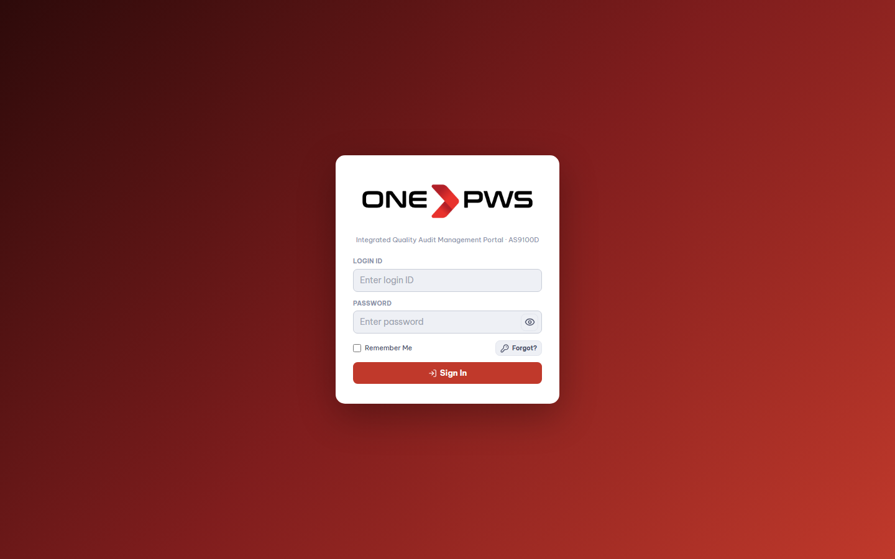

# Standard Operating Procedure & Training Manual
## ONEPWS Complaint & CAPA Management Portal

**Document ID:** `SOP-QMS-08D-001`  
**Effective Date:** October 2026  
**Revision:** Version 2.0  
**Compliance Standards:** ISO 9001:2015 (Clauses 8.7 & 10.2), IATF 16949:2016, VDA 8D, AS9100D  
**Applicability:** All Manufacturing Plants, Quality Engineering, Customer Support, Operations, and Management  

---

## Table of Contents
1. [Purpose & Scope](#1-purpose--scope)
2. [Role-Based Access Control (RBAC) & Responsibilities](#2-role-based-access-control-rbac--responsibilities)
3. [Module 1: Authentication & User Profile Management](#3-module-1-authentication--user-profile-management)
4. [Module 2: Executive Dashboard & Operations KPI Monitoring](#4-module-2-executive-dashboard--operations-kpi-monitoring)
5. [Module 3: Complaint Logging & Registration (External vs Internal)](#5-module-3-complaint-logging--registration-external-vs-internal)
6. [Module 4: End-to-End 8D Problem Solving Lifecycle (D0 to D8)](#6-module-4-end-to-end-8d-problem-solving-lifecycle-d0-to-d8)
   - 6.1 [D0: Emergency Response & Immediate Containment](#61-d0-emergency-response--immediate-containment)
   - 6.2 [D1: Cross-Functional Team (CFT) Formation](#62-d1-cross-functional-team-cft-formation)
   - 6.3 [D2: Problem Description (5W2H)](#63-d2-problem-description-5w2h)
   - 6.4 [D3: Interim Containment Actions (ICA) & Inventory Quarantine](#64-d3-interim-containment-actions-ica--inventory-quarantine)
   - 6.5 [D4: Root Cause Analysis (5-Why & Fishbone 6M)](#65-d4-root-cause-analysis-5-why--fishbone-6m)
   - 6.6 [D5: Permanent Corrective Actions (PCA) & Safety Evaluation](#66-d5-permanent-corrective-actions-pca--safety-evaluation)
   - 6.7 [D6: Implementation, Verification & Horizontal Deployment](#67-d6-implementation-verification--horizontal-deployment)
   - 6.8 [D7: Prevention of Recurrence & Systemic Actions](#68-d7-prevention-of-recurrence--systemic-actions)
   - 6.9 [D8: Formal Recognition & Team Closure](#69-d8-formal-recognition--team-closure)
7. [Module 5: Electronic 3-Tier Signatures & Separation of Duties](#7-module-5-electronic-3-tier-signatures--separation-of-duties)
8. [Module 6: CAPA Lifecycle & Evidence Verification State Machine](#8-module-6-capa-lifecycle--evidence-verification-state-machine)
9. [Module 7: Turnaround Time (TAT) SLAs & Multi-Tier Escalations](#9-module-7-turnaround-time-tat-slas--multi-tier-escalations)
10. [Module 8: Repeat Defect Detection & Recurrence Intelligence](#10-module-8-repeat-defect-detection--recurrence-intelligence)
11. [Module 9: Dynamic Reports Catalog, Excel & Customer 8D PDF Generation](#11-module-9-dynamic-reports-catalog-excel--customer-8d-pdf-generation)
12. [Module 10: Governance, Audit Trail & System Restore](#12-module-10-governance-audit-trail--system-restore)
13. [Module 11: Master Data Administration & Email Automation Governance](#13-module-11-master-data-administration--email-automation-governance)
14. [Module 12: Hands-On Step-by-Step Training Scenarios](#14-module-12-hands-on-step-by-step-training-scenarios)

---

## 1. Purpose & Scope

### 1.1 Purpose
The purpose of this Standard Operating Procedure (SOP) and Training Manual is to define, standardize, and govern the end-to-end handling of Customer (External) and Shop-Floor (Internal) Quality Complaints within the **ONEPWS Complaint & CAPA Management Portal**. It provides mandatory step-by-step guidelines for:
- Logging quality deviations with zero delay.
- Enforcing strict 8D problem-solving methodology (D0 through D8).
- Ensuring rigorous Turnaround Time (TAT) SLA compliance with automated pre-overdue and multi-tier escalation warnings.
- Tracking evidence-backed Corrective and Preventive Actions (CAPA) with independent Quality Head verification.
- Enforcing electronic signature separation of duties and tamper-evident audit logging.

### 1.2 Scope
This procedure applies to all ONEPWS facilities, subsidiaries, customer support representatives, quality engineers, operations personnel, department heads, and executive leadership.

---

## 2. Role-Based Access Control (RBAC) & Responsibilities

The portal operates on a least-privilege, multi-tenant RBAC model. Users are assigned specific operational roles:

| Role Name | Primary Responsibilities | Portal Permissions |
| :--- | :--- | :--- |
| **Complaint Coordinator (CC)** | Logs initial complaints, validates customer claims, assigns initial owners, reviews repeat flags. | `complaint.create`, `complaint.view`, `export.all` |
| **Complaint Owner (CO)** | Leads the 8D investigation, coordinates D0–D8 inputs, executes 5-Why and Fishbone, prepares final signoff. | `complaint.update`, `8d.prepare`, `capa.create` |
| **Department Head (HOD)** | Reviews root cause validity, allocates containment/corrective resources, signs as Reviewer. | `8d.review`, `tat.escalation.view`, `capa.approve` |
| **CAPA Owner** | Executes corrective/preventive actions, uploads objective evidence (photos, docs, test results). | `capa.update`, `capa.evidence.upload` |
| **Quality Head (QH)** | Reviews CAPA evidence (Accept/Reject), validates short/long-term effectiveness, grants final 8D Approval. | `8d.approve`, `capa.verify`, `complaint.close` |
| **Management / BUH** | Monitors executive KPIs, monitors aging defects, receives Level 4 escalations (168h+). | `report.all`, `view.company`, `tat.escalation.view` |
| **Master Admin** | Manages users, company entities, categories, SLA thresholds, email templates, system restore. | `*` (Full administrative power) |

---

## 3. Module 1: Authentication & User Profile Management

### 3.1 Portal Login & Security
All users access the portal via a modern web browser (Google Chrome, Microsoft Edge, Mozilla Firefox) at the designated corporate URL (`https://care.onepws.com` or local portal IP).


#### Step-by-Step Login Instructions:
1. Navigate to the login URL.
2. Enter your corporate **Username** (or Registered Email Address).
3. Enter your assigned **Password**.
4. *(Optional)* Check **Remember username** to save your login ID on this workstation.
5. Click **Sign In**.
6. **First-Time Sign-In / Temporary Password:**
   - If your account was newly provisioned by the Administrator, you will be prompted to change your temporary password immediately.
   - Passwords must be at least **8 characters** long and include uppercase, lowercase, numbers, and special characters.

### 3.2 User Profile & Security Settings
Users can review their personal details, assigned organizational roles, company access scope, and update credentials under **Profile Settings**.



#### Profile Management Steps:
1. Click your name / avatar in the bottom left sidebar navigation.
2. Review your assigned **Role** and **Company Scope**.
3. Under **Change Password**, provide your current password followed by your new password.
4. Click **Update Password**.

---

## 4. Module 2: Executive Dashboard & Operations KPI Monitoring

The Executive Dashboard provides an immediate 360-degree overview of plant quality health, SLA compliance, open complaints, and pending actions.


### 4.1 Key Performance Indicator (KPI) Metric Cards
- **Total Registered Complaints:** Aggregate volume of external and internal cases logged in the current financial year.
- **Open Complaints:** Cases currently undergoing containment, root cause investigation, or CAPA completion.
- **Critical & High Priority Complaints:** Urgent deviations requiring immediate C-suite or Plant Manager attention.
- **Overdue TAT Items:** Tasks that have breached configurable stage turnaround deadlines.
- **Recurrence Rate (%):** Percentage of complaints flagged as repeat defects within the rolling repeat window (Target: `< 2.0%`).

### 4.2 Interactive Charts & Filters
- **Complaints by Stage:** Bar breakdown across Registered, Acknowledged, Containment (D3), RCA (D4), CAPA (D5-D6), and Closed.
- **Priority Distribution:** Donut distribution of Critical, High, Medium, and Low severity issues.
- **Company & Date Filtering:** Top bar filters allow filtering data by single plant, business unit, or custom date ranges.

---

## 5. Module 3: Complaint Logging & Registration (External vs Internal)

### 5.1 Accessing the Complaints Register
Click **Complaints** in the main sidebar to view the Master Complaint Registry.


The Complaints Register features:
- Live search across Complaint Number, Customer, Product, or Batch.
- Multi-dimensional filtering by Type (`External` vs `Internal`), Current Status (`Open`, `In Progress`, `Under Review`, `Closed`), and Priority.
- Quick Excel Export button to download filtered views immediately.

### 5.2 Creating a New Complaint (Step-by-Step)
Click the **+ Log Complaint** button in the upper right corner to launch the Registration Wizard.


#### Mandatory Form Fields:
1. **Complaint Type Selection:**
   - **External (Customer 8D):** For customer-reported non-conformances, warranty returns, or field failures. Enforces the complete D0–D8 problem-solving framework.
   - **Internal (Shop-Floor):** For internal non-conformances, scrap spikes, process deviations, or incoming supplier defects. Uses a streamlined investigation workflow.
2. **Priority Selection:**
   - **Critical (Multiplier: 0.5x):** High business or safety impact. Stage deadlines halved.
   - **High (Multiplier: 0.75x):** Production stoppage or major customer risk.
   - **Medium (Multiplier: 1.0x):** Standard operational turnaround time.
   - **Low (Multiplier: 1.5x):** Minor cosmetic or documentation issues.
3. **Customer & Identification Details (For External):**
   - Customer Name, Customer Contact, Location, Purchase Order (PO) Number.
4. **Product & Traceability:**
   - Product Name, Part Number, Batch / Lot Number, Quantity Affected.
5. **Organizational Ownership:**
   - Responsible Department (e.g., Production, Quality Assurance, Tooling, Maintenance).
   - Defect Category and Subcategory.
   - Assigned Complaint Owner (SPOC).
6. **Defect Description:**
   - Detailed, factual narrative explaining the defect symptoms.
7. Click **Register Complaint**.

> [!NOTE]
> Upon registration, the portal automatically allocates a concurrency-safe financial-year complaint number (e.g., `CMP-26-00012` or `PWS-26-27-00001`) and triggers automated email notifications to the Complaint Owner and Department Head.

---

## 6. Module 4: End-to-End 8D Problem Solving Lifecycle (D0 to D8)

Opening any complaint record displays the Complaint Detail Workspace:


The header displays:
- Complaint Status & Overall TAT Health (`On Time`, `Due Soon`, `Overdue`).
- Quick action buttons: **Download 8D PDF**, **Export 8D Excel**, and **Close Complaint**.
- Navigation tabs: **Overview**, **8D Investigation**, **CAPA Actions**, **Effectiveness**, **Attachments**, **Notes & MOM**, **Workflow Timeline**, and **Audit Trail**.

---

### 6.1 D0: Emergency Response & Immediate Containment
Select the **8D Investigation** tab to enter the structured problem-solving engine.


#### Operational Guidelines:
- Document immediate safety checks, line stoppages, and initial quarantine at customer or dispatch warehouse.
- Ensure the D0 entry clearly details what actions were taken within the first **24 hours** of complaint notification.

---

### 6.2 D1: Cross-Functional Team (CFT) Formation
An effective 8D team requires multi-disciplinary representation.
- Click **+ Add Team Member**.
- Record member **Name**, **Department**, **Email**, and designated **Role** (e.g., *Champion*, *Team Leader*, *Quality Member*, *Process Specialist*).
- System validates that at least one Leader and one Quality Representative are assigned before allowing progression.

---

### 6.3 D2: Problem Description (5W2H)
The 5W2H framework prevents vague problem definitions:

| 5W2H Dimension | Question to Answer | Example Entry |
| :--- | :--- | :--- |
| **What** | What specific defect or non-conformance occurred? | Burr observed on outer diameter edge. |
| **Where** | Where geographically and on the physical component is it found? | Top flange, customer assembly line #2. |
| **When** | When was the defect first observed? | During morning shift assembly on Oct 12. |
| **Who** | Who reported and identified the defect? | Quality Inspector at Customer Incoming QC. |
| **Why / Involved** | Why is this an operational abnormality? | Part exceeds maximum drawing tolerance (+0.05 mm). |
| **How** | How was the defect detected? | Visual inspection and vernier caliper check. |
| **How Many** | What is the total lot size and defect count? | 45 defective parts out of a batch of 1,200 (3.75%). |

---

### 6.4 D3: Interim Containment Actions (ICA) & Inventory Quarantine


#### Containment Procedure:
1. Conduct 100% sorting across all 4 inventory locations:
   - **At Customer Premise:** Stock sorted, certified, or returned.
   - **In Transit:** Shipments quarantined or inspected at warehouse hubs.
   - **In Finished Goods Warehouse:** 100% sorting with green dot identification stickers.
   - **In Work-in-Progress (WIP) & Raw Material:** Production halted until boundary samples verified.
2. In the **D3 Action Table**, list each specific containment action, assigned **Responsible Person**, **Target Completion Date**, and current **Status**.
3. Confirm that no suspect inventory can reach the customer before moving forward.

---

### 6.5 D4: Root Cause Analysis (5-Why & Fishbone 6M)

The portal incorporates dual complementary RCA methodologies:


#### 1. Ishikawa Fishbone (6M Breakdown):
Brainstorm and record contributing factors across the 6 industrial branches:
- **Man:** Training deficiencies, operator fatigue, lack of adherence to standard work.
- **Machine:** Tool wear, calibration lapse, hydraulic pressure fluctuations, spindle runout.
- **Material:** Raw material hardness variation, supplier batch inconsistency.
- **Method:** Ambiguous work instructions, incorrect cutting speed/feed parameters.
- **Measurement:** Micrometer gauge error, improper lighting, parallax error.
- **Milieu (Environment):** Ambient temperature variation affecting thermal expansion.

#### 2. Three-Legged 5-Why Root Cause Chains:
To prevent recurrence, the root cause must be analyzed across three separate chains:
- **Occurrence Root Cause:** Why did the physical defect occur during production?
- **Escape / Detection Root Cause:** Why did our inspection systems fail to detect the defect before shipment?
- **Systemic Root Cause:** Why did the Quality Management System / FMEA not anticipate and prevent this failure mode?

Click **+ Add Why** to progressively dig through causal layers until the undeniable root cause is established.

---

### 6.6 D5: Permanent Corrective Actions (PCA) & Safety Evaluation


#### Corrective Action Guidelines:
- Develop specific, irreversible solutions addressing each root cause identified in D4.
- Split actions across:
  - **Occurrence PCA:** E.g., Install automatic tool wear offset sensor on CNC machine.
  - **Escape PCA:** E.g., Implement automated optical inspection (AOI) poke-yoke vision camera.
  - **Systemic PCA:** E.g., Update Process FMEA and increase Risk Priority Number (RPN) detection rating.
- Conduct a **Safety Evaluation** to ensure proposed modifications introduce zero workplace or operational hazards.

---

### 6.7 D6: Implementation, Verification & Horizontal Deployment
- Track verification data proving the PCA eliminates the defect under real production conditions.
- **Quality Document Revision Matrix:** Record revisions to engineering and process documents:
  - Process Flow Chart
  - Control Plan
  - PFMEA (Process Failure Mode & Effects Analysis)
  - Standard Operating Procedure (SOP) / Work Instructions
  - Engineering Drawings
- **Horizontal Deployment:** Identify sibling lines, identical machinery, or similar product families where the same countermeasure must be implemented proactively.

---

### 6.8 D7: Prevention of Recurrence & Systemic Actions


- **Short-Term Effectiveness Check:** Scheduled at **30 days** post-implementation. Inspect next 3 consecutive production batches.
- **Long-Term Effectiveness Check:** Scheduled at **90 days** post-implementation. Audit warranty claims and customer returns.
- **Automated Reopen Enforcement:** If recurrence is observed during either check, the portal automatically flags the defect as `Not Effective` and reopens the complaint for immediate re-investigation.

---

### 6.9 D8: Formal Recognition & Team Closure
- Acknowledge the contributions of the cross-functional team.
- Capture lessons learned for the organizational knowledge base.
- Archive the complaint record upon achieving all closure criteria.

---

## 7. Module 5: Electronic 3-Tier Signatures & Separation of Duties

To comply with FDA 21 CFR Part 11, ISO 9001, and automotive audit standards, the portal enforces a tamper-resistant three-tier digital signature hierarchy:


### 7.1 Signature Workflow
1. **Tier 1: Prepared by (Complaint Owner / Champion):**
   - Certifies that D0 through D8 sections have been thoroughly investigated and documented.
   - Enters date and electronic signature stamp.
2. **Tier 2: Reviewed by (Department Head / HOD):**
   - Certifies that technical root causes are valid and departmental resources are deployed.
3. **Tier 3: Approved by (Quality Head):**
   - Grants final organizational and executive release. Authorizes customer 8D submission.

### 7.2 Strict Audit Governance Rules:
- **Separation of Duties:** The user who signs *Prepared by* cannot sign *Reviewed by* or *Approved by*. The system prevents self-approval.
- **Revocation Cascade:** If any upstream 8D data (D2, D4, D5) is edited after a signature has been affixed, all downstream signatures are automatically **revoked** with an audit reason logged in the system.

---

## 8. Module 6: CAPA Lifecycle & Evidence Verification State Machine

The CAPA system governs corrective actions through an evidence-backed state machine.

### 8.1 CAPA Analytics Dashboard
Navigate to **CAPA -> CAPA Dashboard** to monitor global action status, aging distribution, and completion rates.


### 8.2 CAPA Tracker & Evidence Review
Navigate to **CAPA -> CAPA Tracker** to view all active action items.


Each CAPA is assigned a unique identifier (`<ComplaintNumber>-CAPA-XX`, e.g., `PWS-22-23-00001-CAPA-01`).

### 8.3 Four-Stage Evidence Verification Workflow:
1. **Stage 1 (Assignment):** Action assigned with target deadline and action owner. Status: `Open` / `In Progress`.
2. **Stage 2 (Evidence Submission):**
   - Action owner implements countermeasure.
   - Owner uploads signed objective evidence (photographs, calibration records, modified SOPs, training sign-in sheets).
   - Status changes to: `Evidence Uploaded (Pending Review)`.
3. **Stage 3 (Quality Head Independent Review):**
   - Quality Head reviews uploaded evidence.
   - **Accept Action:** Evidence meets standard; moves to `Verification` stage.
   - **Reject Action:** Evidence is insufficient. Quality Head must provide mandatory written remarks explaining deficiencies. Status resets to `Under Revision`.
4. **Stage 4 (Effectiveness & Formal Closure):**
   - After sustainment checks, CAPA status moves to `Completed` and `Closed`.

---

## 9. Module 7: Turnaround Time (TAT) SLAs & Multi-Tier Escalations

The portal enforces rigorous SLA milestones to prevent customer response delays.


### 9.1 Stage Milestone Deadlines

| Workflow Stage | Baseline Target | Critical (0.5x) | High (0.75x) | Medium (1.0x) | Low (1.5x) |
| :--- | :--- | :--- | :--- | :--- | :--- |
| **Acknowledgement (D0/D1)** | 24 Hours | 12 Hours | 18 Hours | 24 Hours | 36 Hours |
| **Containment (D3)** | 48 Hours | 24 Hours | 36 Hours | 48 Hours | 72 Hours |
| **Root Cause Analysis (D4)** | 120 Hours | 60 Hours | 90 Hours | 120 Hours | 180 Hours |
| **CAPA Assignment (D5)** | 168 Hours (7 Days) | 84 Hours | 126 Hours | 168 Hours | 252 Hours |
| **Overall 8D Closure** | 720 Hours (30 Days) | 360 Hours | 540 Hours | 720 Hours | 1080 Hours |

### 9.2 Automated Pre-Overdue Warnings
The cron engine evaluates active cases every hour and delivers automated alert emails:
- **50% of SLA Elapsed:** Gentle reminder to Complaint Owner.
- **75% of SLA Elapsed:** Warning alert to Owner and Department Head.
- **90% of SLA Elapsed:** High-priority breach impending alert.

### 9.3 Multi-Tier Overdue Escalation Matrix

```
[0 Hours Overdue]   ---> Tier 1: Action Owner (Immediate Breach Notice)
[24 Hours Overdue]  ---> Tier 2: Department Head (Escalation Level 1)
[72 Hours Overdue]  ---> Tier 3: Quality Head (Escalation Level 2)
[168 Hours Overdue] ---> Tier 4: BUH / Executive Management (Critical Escalation)
```

### 9.4 Delay Reasons Capturing
When completing a stage past its SLA deadline, the system prompts for a mandatory **Delay Reason** (e.g., *Customer delayed providing sample*, *Awaiting metallurgical lab report*, *Vendor tooling delay*). These reasons feed into Pareto charts for systemic bottleneck removal.

---

## 10. Module 8: Repeat Defect Detection & Recurrence Intelligence

Recurring defects indicate ineffective root cause elimination. The portal features an automated repeat intelligence engine.


### 10.1 Automated Matching Rules
When a new complaint is registered, the engine scans the previous **180 days** (configurable) for matching attributes:
- **Company / Plant Entity** matches, AND
- **Defect Category & Subcategory** matches, AND
- **Customer OR Product/Part Number** matches.

### 10.2 Repeat Investigation Requirements
- Flagged complaints display a prominent red **Repeat Defect** badge.
- The 8D team must inspect prior linked 8D reports to establish why earlier CAPAs failed to prevent recurrence.
- Management review is mandatory before formal closure of any repeat case.

---

## 11. Module 9: Dynamic Reports Catalog, Excel & Customer 8D PDF Generation

Navigate to **Governance -> Reports** to access enterprise reporting.


### 11.1 Dynamic Reports Catalog
- **Complaint Master Register:** Complete log with dates, customers, and stage timestamps.
- **CAPA Implementation Tracker:** Aging, evidence status, and verification notes.
- **SLA Breach & Escalation Report:** Historical breach frequencies and delay reasons.
- **Repeat Defect Pareto Summary:** Top defect categories causing repeat customer dissatisfaction.

### 11.2 Customer 8D PDF Generation
Click **Download 8D PDF** on any complaint workspace to generate an industry-standard, publication-ready multi-page Customer 8D Report containing:
- Corporate branding and complaint metadata.
- Detailed D0 through D8 sections with 5W2H tables.
- Rendered 5-Why chains and Fishbone 6M breakdowns.
- Complete CAPA table with verification dates.
- Cryptographically verified 3-tier electronic signature stamps.

---

## 12. Module 10: Governance, Audit Trail & System Restore

To satisfy rigorous compliance audits, every action within the portal is immutably recorded.


### 12.1 Tamper-Evident Audit Logging
The Audit Trail captures:
- Exact **Timestamp** (UTC & Local Time).
- **Actor Identity** (Name, Username, Role, IP Address).
- **Action Type** (`LOGIN`, `CREATE`, `UPDATE`, `SIGNATURE_AFFIXED`, `STATUS_CHANGE`, `EVIDENCE_UPLOAD`, `CLOSE`).
- **Entity & Record ID**.
- **Before & After Values** of modified data.

### 12.2 Excel Bulk Import & Export
Authorized managers can bulk import historical legacy spreadsheets or export current records for external statistical modeling.


---

## 13. Module 11: Master Data Administration & Email Automation Governance

Master Administrators configure corporate governance parameters under **Master Data** and **Email Automation**.

### 13.1 Master Data Governance
Navigate to **Governance -> Master Data** to configure:


- **User Accounts & Roles:** Provision new personnel and assign RBAC roles.
- **Plant / Company Entities:** Multi-tenant plant setup.
- **Departments:** Operational departments (Production, QA, Tooling, Maintenance, Dispatch).
- **Categories & Subcategories:** Defect classification taxonomies.
- **Priorities & TAT Deadlines:** Tuning baseline hours and priority multipliers.
- **Delay Reasons:** Standardized delay codes.

### 13.2 Email Automation & Live SMTP Governance
Navigate to **Governance -> Email Automation** to monitor email health and template configuration:


- **Live SMTP Status:** Real-time connection status check to the mail relay.
- **34 Pre-Configured Templates:** Formatted HTML templates covering all workflow triggers (Complaint Registered, Containment Due, Overdue Escalation, Signatures Required, CAPA Verification, Weekly Digest).
- **Variable Insert Helper:** Interactive tag picker (`{{complaint.number}}`, `{{customer.name}}`, `{{dueAt}}`, `{{portalUrl}}`).
- **Delivery Audit Logs & Retry:** Complete trace of dispatched emails with error diagnostics and 1-click retry for failed deliveries.

---

## 14. Module 12: Hands-On Step-by-Step Training Scenarios

### Scenario A: Handling an Urgent Customer Complaint
*Role: Complaint Coordinator & Complaint Owner*

1. **Reception (T = 0h):** Receive customer email reporting dimensional defect on Control Desk batch #902.
2. **Logging:** Log in, click **+ Log Complaint**. Select **External**, Priority **High**, Customer *Thales*, Product *Control Desk*.
3. **Immediate Containment (T < 24h):** Open complaint workspace. Click **8D Investigation**. In **D0**, document quarantine at customer site and dispatch hold.
4. **Team Formation (D1):** Add Quality Engineer, Production Supervisor, and Tooling Lead.
5. **Containment Actions (D3, T < 48h):** Enter 100% sorting results in D3. Verify zero defect escape.

### Scenario B: Conducting RCA & Assigning CAPAs
*Role: Complaint Owner & Cross-Functional Team*

1. **5W2H Problem Definition (D2):** Complete What, Where, When, Who, Why, How, How Many.
2. **Fishbone (D4):** Brainstorm 6M factors. Identify worn cutting insert on CNC Milling machine #4.
3. **5-Why Execution (D4):**
   - Why 1: Outer diameter oversized $\rightarrow$ Cutting tool worn.
   - Why 2: Tool worn prematurely $\rightarrow$ Coolant flow blocked by swarf.
   - Why 3: Swarf blocked nozzle $\rightarrow$ Filter mesh torn.
   - Why 4: Mesh torn $\rightarrow$ Preventive maintenance schedule exceeded.
   - Why 5 (Systemic Root Cause): PM checklist lacked filter integrity verification clause.
4. **Permanent Corrective Actions (D5):** Add PCA to replace filter, add daily coolant pressure sensor, and update PM checklist SOP.
5. **CAPA Creation:** Assign CAPA to Maintenance Lead with target date within 7 days.

### Scenario C: Evidence Upload & Quality Head Review
*Role: CAPA Owner & Quality Head*

1. **Evidence Upload:** Maintenance Lead executes work, captures photo of installed sensor and signed PM SOP. Clicks **CAPA Tracker**, uploads evidence documents. Status becomes `Evidence Uploaded`.
2. **Quality Head Review:** Quality Head opens CAPA review modal. Inspects photo and revised SOP.
3. **Acceptance:** Quality Head confirms evidence satisfies standard and clicks **Accept Evidence**.

### Scenario D: 3-Tier Signatures & Formal Closure
*Role: Complaint Owner, Department Head, Quality Head*

1. **Prepared by:** Complaint Owner verifies all D0–D8 entries are complete. Enters signature stamp under **Signatures** tab.
2. **Reviewed by:** Production HOD verifies and enters electronic signature.
3. **Approved by:** Quality Head approves report.
4. **Close Complaint:** Quality Head clicks **Close Complaint**, enters formal closure remarks, and confirms no repeat defects in 30 days. Status transitions to `Closed`.
5. **Customer Submission:** Click **Download 8D PDF** and dispatch official 8D report to customer.

---

*End of Standard Operating Procedure & Training Manual (`SOP-QMS-08D-001`).*
